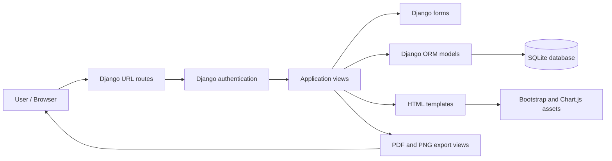
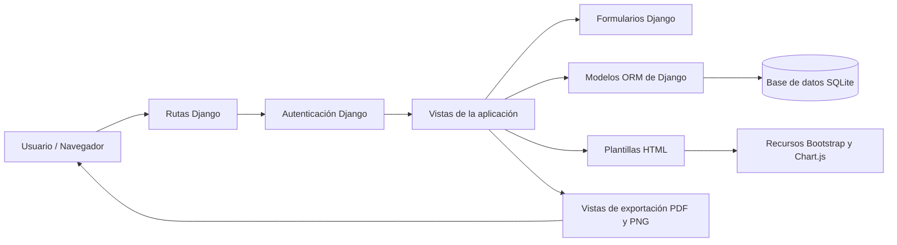

# Intelligence Incident Management System


## English

This project is a Django-based web application for recording, tracking, filtering, and summarizing intelligence-related incidents. It was designed for operational reporting, territorial analysis, and fast access to incident history with a professional dashboard and exportable files.

## Overview

The system allows users to:

- register security or intelligence incidents with complete details;
- classify incidents by activity type and territory;
- associate municipalities and involved parties;
- upload an optional supporting image;
- generate reports in PDF and PNG formats;
- review recurring activities and territory-based distribution;
- manage users and authentication through Django.

This project is intended for internal operational management and can be used as a reporting base for security units, analysis teams, or intelligence workflows.

**Repository:** <https://github.com/LiAngel01/Intelligence-App>

## Core features

- Dashboard with summary metrics and visual analytics.
- Monthly and quarterly trend charts by incident type.
- Territorial distribution and most active region statistics.
- Incident form with date, time, informant, region, municipality, activity, involved parties, and notes.
- Full incident list with search and filter capabilities.
- Edit and delete operations for completed records.
- Additional incident entry model for auxiliary or complementary reporting.
- Summary table by activity and territory.
- PDF and image exports for reports and analysis tables.
- Django authentication and login protection for selected operational endpoints.

## Project structure

```text
.
├── App/
│   ├── migrations/            # Database migration files
│   ├── static/                # CSS, JS, images, and frontend assets
│   ├── templates/             # HTML templates
│   ├── admin.py               # Admin registration
│   ├── forms.py               # Django form definitions
│   ├── image_views.py         # PNG export generation
│   ├── models.py              # Database models and business logic
│   ├── pdf_views.py           # PDF generation utilities
│   ├── signals.py             # Application signals
│   ├── tests.py               # Automated tests
│   ├── urls.py                # App URL routing
│   └── views.py               # Main backend logic
├── intelligence_project/      # Django project configuration
├── Media/                     # Uploaded media files (development)
├── db.sqlite3                 # Local SQLite database
├── manage.py                  # Django entry point
├── requirements.txt            # Python dependencies
├── README.md                  # Project documentation
└── .venv/                     # Virtual environment (optional)
```

## Architecture

The application follows Django's request/response pattern. URL routes dispatch requests to views; views use forms and models to validate and query data; templates render the interface; export views generate downloadable files.



The default SQLite database can be replaced with another Django-supported database by changing the project settings.

## Main technologies and libraries

The project relies on the following libraries and tools:

- Python 3.12+
- Django 5.2
- SQLite 3
- Pillow
- xhtml2pdf
- Bootstrap 5 (used through project static files)
- Chart.js (dashboard charts)

### Dependency list

The project dependencies are declared in [`requirements.txt`](requirements.txt):

```text
Django>=5.2,<5.3
Pillow>=11,<13
xhtml2pdf>=0.2.17,<0.3
```

### Why these libraries are used

- Django: application framework, routing, views, ORM, authentication, templates.
- Pillow: image generation and processing for exported images and visual reporting.
- xhtml2pdf: HTML-to-PDF conversion for report generation.
- SQLite: lightweight local database ideal for development and small deployment environments.
- Bootstrap and Chart.js: user interface design and dashboard charts.

## Installation

### 1. Clone the repository

```bash
git clone https://github.com/LiAngel01/Intelligence-App.git
cd Intelligence-App
```

### 2. Create a virtual environment

#### Windows PowerShell

```powershell
py -m venv .venv
.\.venv\Scripts\Activate.ps1
```

#### Bash / Linux / macOS

```bash
python -m venv .venv
source .venv/bin/activate
```

### 3. Install dependencies

```bash
pip install -r requirements.txt
```

### 4. Configure environment

For local development, Django uses a development-only key when no environment variables are configured. Do not use this fallback in production. Set a unique secret key and allowed hosts before deployment.

#### Windows PowerShell

```powershell
$env:DJANGO_DEBUG = "False"
$env:DJANGO_SECRET_KEY = "<generate-a-unique-secret-key>"
$env:DJANGO_ALLOWED_HOSTS = "your-domain.example"
```

#### Bash / Linux / macOS

```bash
export DJANGO_DEBUG=False
export DJANGO_SECRET_KEY="<generate-a-unique-secret-key>"
export DJANGO_ALLOWED_HOSTS="your-domain.example"
```

See [`.env.example`](.env.example) for the supported variable names. The application reads environment variables from the process; it does not automatically load a `.env` file.

### 5. Apply migrations

```bash
python manage.py migrate
```

### 6. Run the project

```bash
python manage.py runserver
```

Open the application in the browser:

```text
http://127.0.0.1:8000/
```

### 7. Create an admin user

```bash
python manage.py createsuperuser
```

Admin interface:

```text
http://127.0.0.1:8000/admin/
```

## Authentication and access control

The application uses Django authentication. Some operational views and exports require an authenticated session, including:

- Incident creation
- Additional incident creation
- Report generation
- Activity summary generation
- PDF and image exports for reports and summaries

Anonymous users are redirected to the login page.

## Main routes

| Route | Description |
| --- | --- |
| `/` | Dashboard and summary home |
| `/incidents/create/` | Create an incident |
| `/form` | Legacy alias for incident creation |
| `/other-incidents/create/` | Create an auxiliary incident |
| `/formOI` | Legacy alias for auxiliary incidents |
| `/incidents/` | List and filter incidents |
| `/lista` | Legacy alias for incident list |
| `/incidents/<id>/` | Incident detail |
| `/incidents/<id>/edit/` | Edit incident |
| `/incidents/<id>/delete/` | Delete incident |
| `/reports/` | Generate a PDF report |
| `/parte/` | Legacy alias for report generation |
| `/reports/image/` | Export report as PNG |
| `/parte/image/` | Legacy PNG report alias |
| `/activity-summary/` | Show table by activity and territory |
| `/tabla_one` | Legacy alias for activity summary |
| `/activity-summary/image/` | Export table as PNG |
| `/users/` | List users |
| `/users/add/` | Add new user |
| `/users/<id>/edit/` | Edit user |
| `/accounts/` | Django auth routes |

## Data model and core entities

The main application model is `Incident`, which stores operational data such as:

- incident date and time;
- informant;
- activity type;
- territory and municipality;
- involved parties;
- extra details;
- activity description;
- optional uploaded image.

Additional model support includes:

- `OtherIncident`: supplementary records;
- `Usuario` / `UserAccount`: user accounts with region, role, military grade, and unit identifiers.

## Functional details

### Dashboard

The dashboard provides:

- total incident numbers;
- monthly and quarterly trends;
- top territories by volume;
- percentage distribution by region;
- incident counts by type;
- recent operational indicators.

### Reports

The project can generate structured reports in PDF and PNG format based on date filters and incident categories. These outputs are useful for operational briefings and formal documentation.

### Summary tables

The activity summary tables provide aggregated counts by territory and activity type, helping identify patterns, hotspots, and recurring operational trends.

### User management

A dedicated user management flow supports creation and editing of users with operational metadata like region, role, military grade, and military unit.

## Example operational workflow

1. Sign in with an authorized account.
2. Review the dashboard for current totals and monthly or quarterly trends.
3. Register an incident and provide its date, type, territory, municipality, and supporting details.
4. Use the incident list to filter and review stored records.
5. Open the activity summary or generate a PDF/PNG report for the required period.

## Development notes

- The project uses Django migrations to manage schema changes.
- Media files are stored in the `Media/` folder during development.
- The local SQLite database and uploaded media are intentionally excluded from Git to avoid publishing user data.
- A development-only secret key is provided only when `DJANGO_DEBUG` is enabled. Production requires `DJANGO_SECRET_KEY`.
- The default database is SQLite; it is suitable for local development and operational prototypes.
- Legacy Spanish routes remain available as aliases for compatibility with older links and flows.

## Production recommendations

Before deploying to production, consider:

- switching from SQLite to PostgreSQL or MySQL;
- setting `DEBUG = False` in Django settings;
- securing the secret key and environment variables;
- configuring a production web server and static file storage;
- reviewing authentication and permission scopes for operational users;
- enabling database backups and logs;
- using a dedicated media storage system.

---

# Sistema de gestión de incidencias

## Español


Este proyecto es una aplicación web desarrollada en Django para registrar, controlar, filtrar y resumir incidencias relacionadas con inteligencia y seguridad. Está pensado para reportes operativos, análisis territoriales y acceso rápido al historial de incidentes con un panel profesional y archivos exportables.

## Descripción general

El sistema permite:

- registrar incidencias de seguridad o inteligencia con información detallada;
- clasificar eventos por tipo de actividad y territorio;
- asociar municipios y partes implicadas;
- cargar una imagen de apoyo opcional;
- generar reportes en PDF y PNG;
- revisar actividades recurrentes y distribución por territorio;
- gestionar usuarios y autenticación mediante Django.

El proyecto está orientado a la gestión interna operativa y puede servir como base de reportes para unidades de seguridad, análisis o trabajo de inteligencia.

## Funcionalidades principales

- Panel de control con métricas y gráficos analíticos.
- Tendencias mensuales y trimestrales por tipo de incidencia.
- Distribución territorial y estadísticas del territorio más activo.
- Formulario de incidencias con fecha, hora, informante, territorio, municipio, actividad, implicados y observaciones.
- Listado completo de incidencias con búsqueda y filtros.
- Edición y eliminación de registros.
- Modelo de incidencias complementarias para reportes auxiliares.
- Tablas resumidas por actividad y territorio.
- Exportación de reportes en PDF y PNG.
- Autenticación de Django y protección de acceso a determinados endpoints operativos.

## Estructura del proyecto

```text
.
├── App/
│   ├── migrations/            # Archivos de migración de la base de datos
│   ├── static/                # CSS, JS, imágenes y assets del frontend
│   ├── templates/             # Plantillas HTML
│   ├── admin.py               # Registro de modelos en admin
│   ├── forms.py               # Formularios de Django
│   ├── image_views.py         # Generación de exportaciones PNG
│   ├── models.py              # Modelos y lógica del negocio
│   ├── pdf_views.py           # Utilidades para generación PDF
│   ├── signals.py             # Señales de la aplicación
│   ├── tests.py               # Pruebas automatizadas
│   ├── urls.py                # Rutas de la aplicación
│   └── views.py               # Lógica principal del backend
├── intelligence_project/      # Configuración del proyecto Django
├── Media/                     # Archivos subidos en desarrollo
├── db.sqlite3                 # Base de datos SQLite local
├── manage.py                  # Punto de entrada de Django
├── requirements.txt           # Dependencias Python
├── README.md                  # Documentación del proyecto
└── .venv/                     # Entorno virtual (opcional)
```

## Arquitectura

La aplicación sigue el patrón de solicitud y respuesta de Django. Las rutas dirigen las solicitudes a las vistas; las vistas validan y consultan datos mediante formularios y modelos; las plantillas presentan la interfaz; y las vistas de exportación generan archivos descargables.



La base SQLite predeterminada puede sustituirse por otra base de datos compatible con Django mediante la configuración del proyecto.

## Tecnologías y bibliotecas principales

El proyecto utiliza las siguientes librerías y herramientas:

- Python 3.12+
- Django 5.2
- SQLite 3
- Pillow
- xhtml2pdf
- Bootstrap 5
- Chart.js

### Lista de dependencias

Las dependencias del proyecto están en [`requirements.txt`](requirements.txt):

```text
Django>=5.2,<5.3
Pillow>=11,<13
xhtml2pdf>=0.2.17,<0.3
```

### ¿Para qué sirve cada librería?

- Django: framework principal, rutas, vistas, ORM, autenticación y plantillas.
- Pillow: creación y manipulación de imágenes para reportes visuales.
- xhtml2pdf: conversión de HTML a PDF para parte y reportes oficiales.
- SQLite: base de datos ligera ideal para desarrollo y entornos pequeños.
- Bootstrap y Chart.js: interfaz visual y gráficos del panel principal.

## Instalación

### 1. Clonar el repositorio

```bash
git clone https://github.com/LiAngel01/Intelligence-App.git
cd Intelligence-App
```

### 2. Crear un entorno virtual

#### Windows PowerShell

```powershell
py -m venv .venv
.\.venv\Scripts\Activate.ps1
```

#### Bash / Linux / macOS

```bash
python -m venv .venv
source .venv/bin/activate
```

### 3. Instalar dependencias

```bash
pip install -r requirements.txt
```

### 4. Configurar el entorno

Para desarrollo local, Django usa una clave exclusiva para desarrollo cuando no se configuran variables de entorno. No uses ese valor en producción. Antes del despliegue, configura una clave secreta única y los dominios permitidos.

#### Windows PowerShell

```powershell
$env:DJANGO_DEBUG = "False"
$env:DJANGO_SECRET_KEY = "<genera-una-clave-secreta-unica>"
$env:DJANGO_ALLOWED_HOSTS = "tu-dominio.example"
```

#### Bash / Linux / macOS

```bash
export DJANGO_DEBUG=False
export DJANGO_SECRET_KEY="<genera-una-clave-secreta-unica>"
export DJANGO_ALLOWED_HOSTS="tu-dominio.example"
```

Consulta [`.env.example`](.env.example) para ver los nombres de las variables admitidas. La aplicación lee las variables del proceso; no carga automáticamente archivos `.env`.

### 5. Ejecutar migraciones

```bash
python manage.py migrate
```

### 6. Iniciar la aplicación

```bash
python manage.py runserver
```

Abre la aplicación en el navegador:

```text
http://127.0.0.1:8000/
```

### 7. Crear un usuario administrador

```bash
python manage.py createsuperuser
```

Panel de administración:

```text
http://127.0.0.1:8000/admin/
```

## Autenticación y control de acceso

La aplicación usa autenticación de Django. Algunos endpoints operativos requieren sesión iniciada, incluyendo:

- creación de incidencias;
- creación de incidencias complementarias;
- generación de partes;
- resumen de tabla 1;
- exportación de partes y resúmenes en PDF e imágenes.

Los usuarios anónimos son redirigidos a la vista de login.

## Rutas principales

| Ruta | Función |
| --- | --- |
| `/` | Dashboard y vista principal |
| `/incidents/create/` | Crear una incidencia |
| `/form` | Alias antiguo para crear incidencia |
| `/other-incidents/create/` | Crear una incidencia complementaria |
| `/formOI` | Alias antiguo para incidencia complementaria |
| `/incidents/` | Listar y filtrar incidencias |
| `/lista` | Alias antiguo para listado |
| `/incidents/<id>/` | Detalle de una incidencia |
| `/incidents/<id>/edit/` | Editar incidencia |
| `/incidents/<id>/delete/` | Eliminar incidencia |
| `/reports/` | Generar parte en PDF |
| `/parte/` | Alias antiguo para reportes |
| `/reports/image/` | Exportar parte como PNG |
| `/parte/image/` | Alias PNG antiguo |
| `/activity-summary/` | Mostrar tabla por actividad y territorio |
| `/tabla_one` | Alias antiguo para resumen |
| `/activity-summary/image/` | Exportar tabla como PNG |
| `/users/` | Listar usuarios |
| `/users/add/` | Agregar usuario |
| `/users/<id>/edit/` | Editar usuario |
| `/accounts/` | Rutas de autenticación de Django |

## Modelo de datos y entidades principales

El modelo principal es `Incident`, que guarda información operativa como:

- fecha y hora de la incidencia;
- informante;
- tipo de actividad;
- territorio y municipio;
- partes implicadas;
- detalles adicionales;
- descripción de la actividad;
- imagen opcional.

También existen modelos complementarios para:

- `OtherIncident`: registros auxiliares o complementarios;
- `Usuario` / `UserAccount`: usuarios con región, rol, grado militar y unidad militar.

## Detalles funcionales

### Dashboard

El panel principal ofrece:

- totales de incidencias;
- tendencias mensuales y trimestrales;
- territorio con mayor volumen;
- distribución porcentual por región;
- conteos por tipo de incidente;
- indicadores operativos recientes.

### Reportes

El sistema puede generar reportes estructurados en PDF y PNG con filtros por fechas y tipos de incidencia, útiles para presentaciones operativas y documentación formal.

### Tablas resumidas

Las tablas por actividad y territorio permiten identificar patrones, focos de riesgo y tendencia recurrente en las operaciones.

### Gestión de usuarios

Existe un flujo dedicado para crear y editar usuarios con información operativa como región, rol, grado militar y unidad.

## Ejemplo de flujo de uso

1. Inicia sesión con una cuenta autorizada.
2. Consulta el panel para revisar los totales y las tendencias mensuales o trimestrales.
3. Registra una incidencia con su fecha, tipo, territorio, municipio y detalles de apoyo.
4. Usa el listado de incidencias para filtrar y consultar los registros guardados.
5. Abre el resumen de actividades o genera un reporte PDF/PNG para el período requerido.

## Notas de desarrollo

- El proyecto usa migraciones de Django para manejar cambios de esquema.
- Los archivos multimedia se almacenan en `Media/` durante el desarrollo.
- La base SQLite local y los archivos multimedia subidos se excluyen intencionalmente de Git para evitar publicar datos de usuarios.
- Solo se usa una clave de desarrollo cuando `DJANGO_DEBUG` está activado. En producción se requiere `DJANGO_SECRET_KEY`.
- La base de datos predeterminada es SQLite, adecuada para desarrollo local y prototipos.
- Se conservan rutas antiguas en español como alias para compatibilidad con enlaces previos.

## Recomendaciones para producción

Antes de desplegar en producción, se recomienda:

- cambiar SQLite por PostgreSQL o MySQL;
- poner `DEBUG = False` en la configuración;
- proteger la clave secreta y variables de entorno;
- configurar un servidor web de producción y almacenamiento estático;
- revisar permisos de autenticación y roles operativos;
- habilitar copias de seguridad y logs;
- usar un sistema externo para manejo de archivos multimedia.

## License and usage

No license file is currently included. The owning organization should choose and add the appropriate license before distributing or reusing this project.

Este proyecto está pensado para uso interno y gestión operativa. Actualmente no incluye un archivo de licencia; la organización propietaria debe definir y agregar los términos correspondientes antes de distribuirlo o reutilizarlo.
